# Chapter 1: Question and data

## Why ask how rare a flood stage is?
:::: {.columns}
::: {.column width="60%"}
- NWS sets **action, minor, moderate, and major** flood stages gage by gage, from local impacts

::: {.incremental}
- Each is a *stage*, not a probability: nothing says how often a river reaches it
- Return periods make the four levels comparable across gages and regions
- They also connect impact-based thresholds to the design floods (Q2, Q10, Q100) used in engineering
:::
:::
::: {.column width="40%" .fragment}
| Level | Defined by |
|---|---|
| Action | Prepare to act |
| Minor | Minimal or no property damage |
| Moderate | Some inundation; evacuations possible |
| Major | Extensive inundation and damage |
:::
::::

::: {.takeaway .fragment}
Goal: the annual exceedance probability (AEP) of every NWS threshold at every gage with enough peak-flow record.
:::

## Data: from 9,067 gages to 3,312 fitted sites

| Step | Source | Sites |
|---|---|---:|
| USGS stream gages (study set) | NWIS site metadata | 9,067 |
| Daily discharge record | NWIS daily values | 8,966 |
| Observed stage record | NWIS daily / instantaneous values | 6,630 |
| Matched to an NWS forecast point | HADS crosswalk | 5,611 |
| At least one threshold flow | NWPS flows, else USGS rating curve | 3,350 |
| **LP3 fit passes QC** (≥ 10 peaks, non-degenerate) | NWIS annual peaks | **3,312** |

::: {.small}
Threshold stages and flows from the NWPS API; NWM reach IDs from NWPS, with the USGS NLDI as a fallback (6,604 of 6,605 gages). Median systematic record among QC sites: 74 years (IQR 48–90).
:::

## Threshold stages become flows
:::: {.columns}
::: {.column width="55%"}
- NWS publishes **stages**; frequency analysis needs **flows**
- Where NWPS has no flow, read the stage through the active USGS rating curve

::: {.fragment}
- A stage **above the top of the rating** has no flow, only a floor: it exceeds the rating's maximum flow
- These become **lower bounds** on the return period instead of being dropped
:::
:::
::: {.column width="45%"}
| Level | NWPS | Rating | Above rating |
|---|---:|---:|---:|
| Action | 656 | 2,486 | 125 |
| Minor | 628 | 2,326 | 235 |
| Moderate | 568 | 1,905 | 477 |
| Major | 546 | 1,444 | **873** |
:::
::::

::: {.takeaway .fragment}
At the major level, 30% of thresholds are above the rating, and they are the rarest floods.
:::

# Chapter 2: Flood frequency analysis

## Annual peaks and Bulletin 17C
:::: {.columns}
::: {.column width="55%"}
- **236,743** annual peaks from NWIS at 3,337 gages
- Log-Pearson III fitted with the **Expected Moments Algorithm** (EMA), following Bulletin 17C

::: {.fragment}
- Peak codes drive how each peak enters the fit:
:::
:::
::: {.column width="45%" .fragment}
| Peaks | Treatment |
|---|---|
| Code 1 (daily mean) | dropped (3,616) |
| Code 4 / 8 | left / right censored |
| Code 7 (historical) | historical period (566 sites) |
| MGBT low outliers | censored PILFs (871 sites) |
| Code 5 / 6 (regulation) | kept as observed |
:::
::::

## Period of record
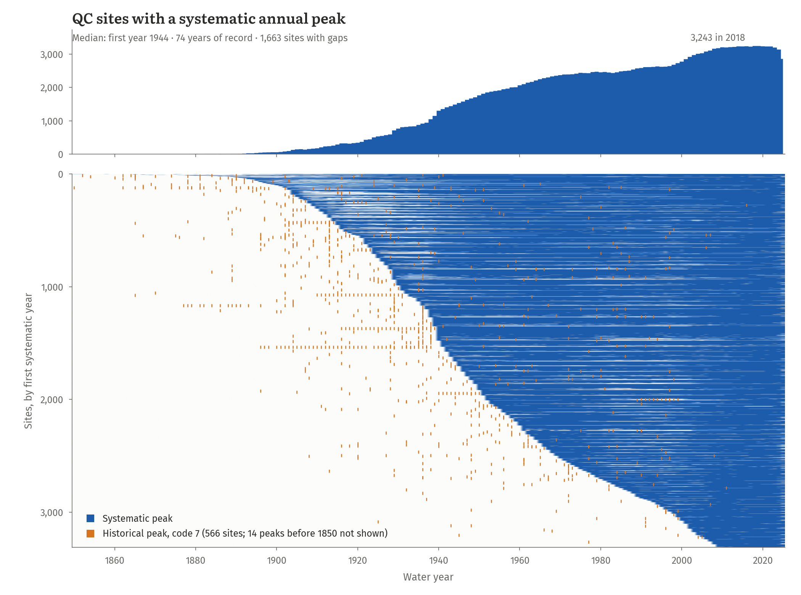{fig-align="center" height="800"}

::: {.small}
Systematic years exclude code-1 (daily mean) peaks; code-7 historical peaks enter the EMA through their historical period.
:::

## Where records are long and short
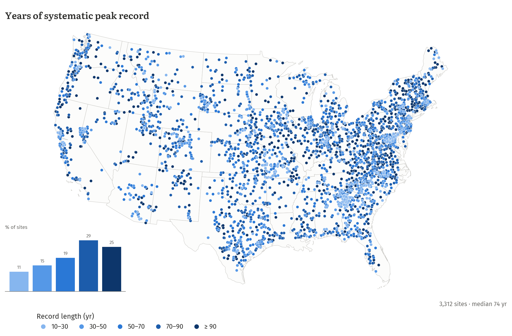{fig-align="center" height="690"}

::: {.takeaway .fragment}
74% of sites have at least 50 years of record and 96% run through 2024 or later. Short records cluster in the Southeast Piedmont and the Mid-Atlantic.
:::

## Station skew for all of CONUS
:::: {.columns}
::: {.column width="55%"}
- Bulletin 17C weights station skew with a regional skew
- Published regional-skew studies cover only 16 states (26% of fitted sites)
- Mixing the two would make results depend on the state line

::: {.fragment}
- So: **station (at-site) skew everywhere**, regional values kept in data product
:::
:::
::: {.column width="45%" .fragment}
Effect where regional skew exists:

| Quantile | Median change | 90th pct. \|change\| |
|---|---:|---:|
| Q2 | −0.2% | 3% |
| Q10 | +0.2% | 2% |
| Q100 | +1.1% | 14% |
| Q500 | +1.8% | 23% |
:::
::::

::: {.takeaway .fragment}
Typical flows barely move; the cost is in the tails, which is where regional skew helps.
:::

## From a fitted curve to a threshold return period
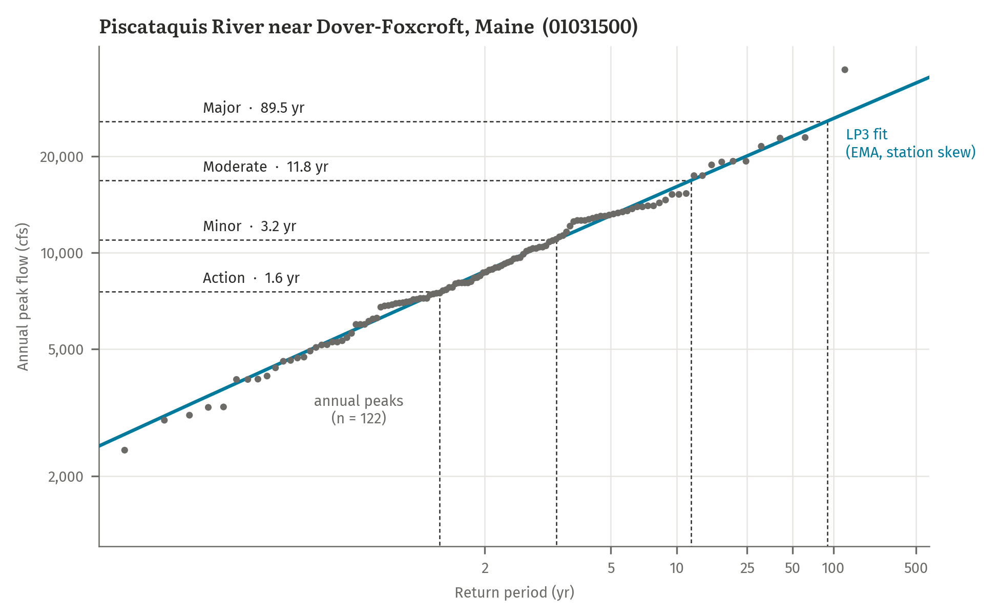{fig-align="center" height="760"}

::: {.small}
Each threshold flow is read across to the LP3 curve: AEP = 1 − F(Q~threshold~), return period = 1 / AEP.
:::

## Check against published USGS estimates
:::: {.columns}
::: {.column width="42%"}
- Our quantiles vs StreamStats station estimates at the same gages (1,789 of 3,312 QC sites)
- Close at common floods, looser in the tail, as expected with station skew

| Quantile | n | R² (log) | Within 25% |
|---|---:|---:|---:|
| Q2 | 1,652 | 0.97 | 90% |
| Q10 | 1,616 | 0.97 | 91% |
| Q100 | 1,718 | 0.95 | 81% |
| Q500 | 1,670 | 0.92 | 71% |

::: {.fragment}
- Q2 also checked against each gage's empirical median annual peak, at **every** site: median ratio 0.99
:::
:::
::: {.column width="58%"}
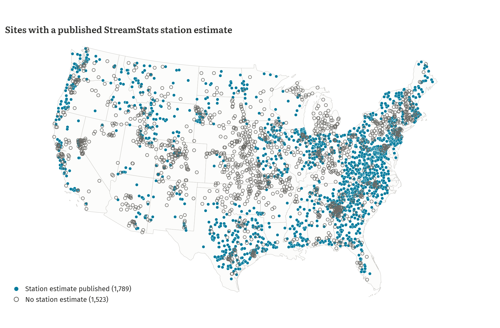{width="100%"}

::: {.small}
Coverage follows state USGS reports and skips regulated gages often.
:::
:::
::::

# Chapter 3: Results

## Return periods at every gage
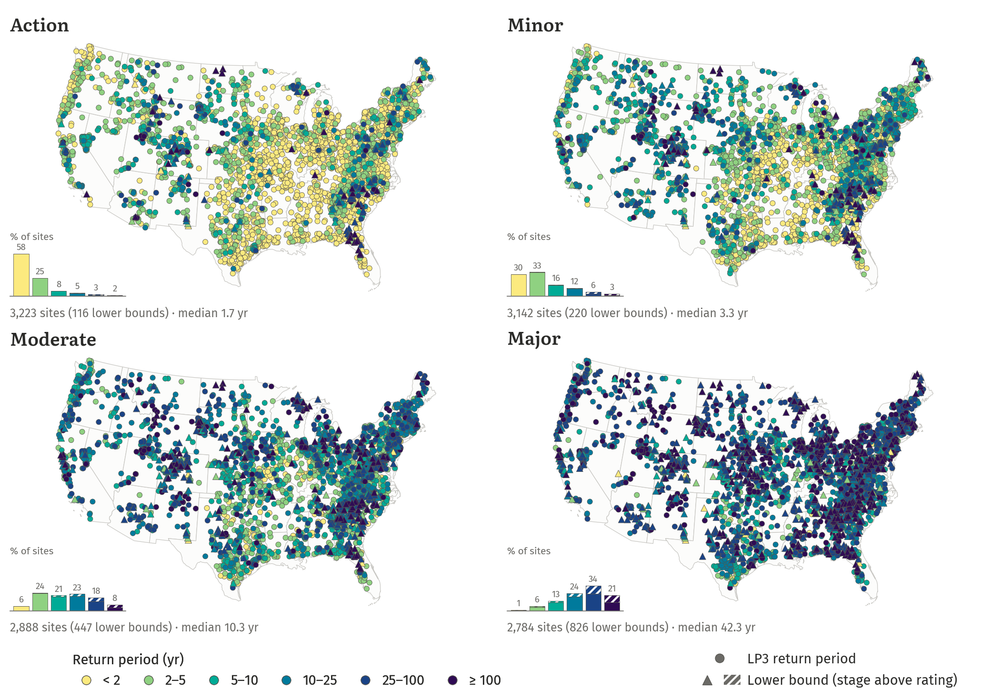{fig-align="center" height="830"}

## Regional patterns
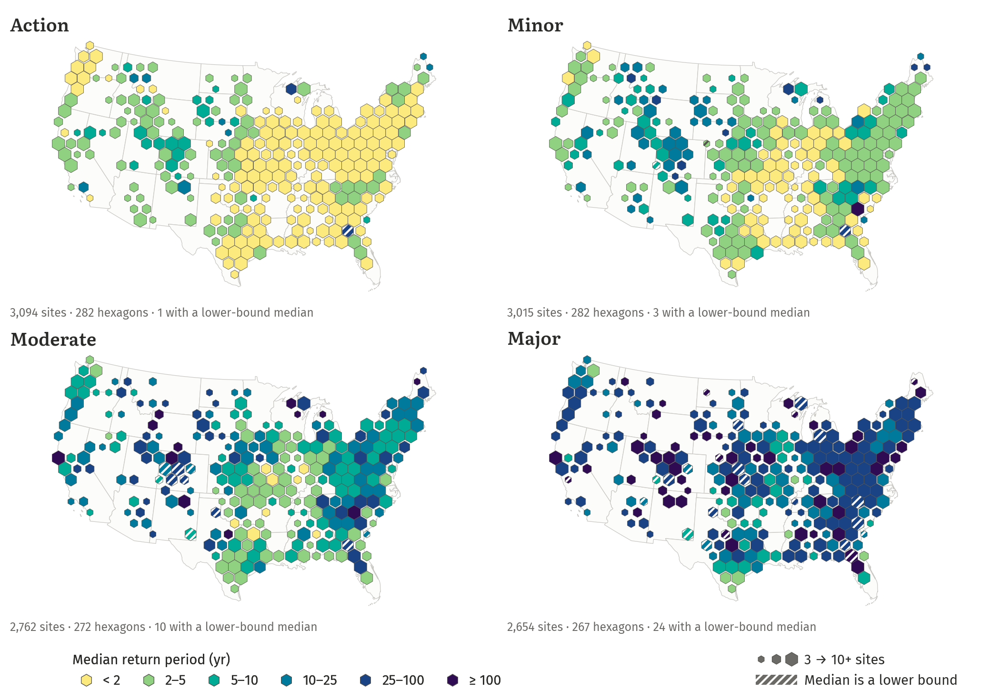{fig-align="center" height="830"}

## How return periods are distributed
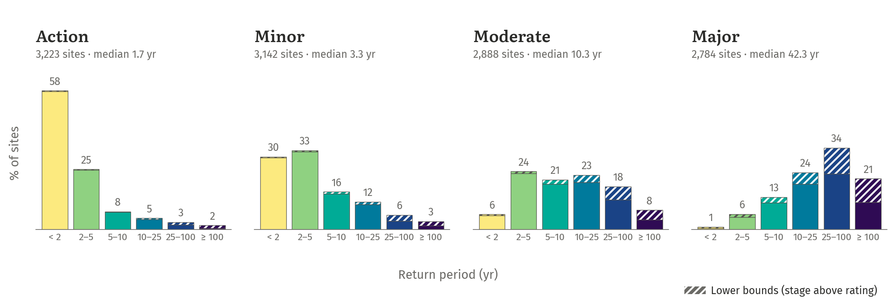{fig-align="center" width="100%"}

::: {.takeaway .fragment}
Lower bounds (hatched) are a small share at action and minor; at major they are a third of the 25–100 yr bar and nearly half of the ≥ 100 yr bar.
:::

## How far beyond the record?
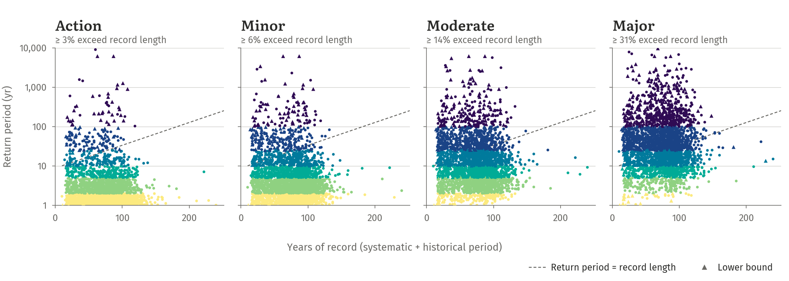{fig-align="center" width="100%"}

::: {.takeaway .fragment}
At least 32% of major thresholds have return periods longer than the record behind them: those rest on the LP3 tail, not on observed floods.
:::

## Lower bounds change the answer
:::: {.columns}
::: {.column width="50%"}
- Medians use Kaplan–Meier survivor analysis, treating each above-rating threshold as "at least" its bound

::: {.fragment}
- Dropping them instead removes the rarest floods and biases the median low
:::
:::
::: {.column width="50%"}
| Level | Sites | Lower bounds | Median RP |
|---|---:|---:|---:|
| Action | 3,223 | 116 | [1.7 yr]{.rp-lt2} |
| Minor | 3,142 | 220 | [3.3 yr]{.rp-2-5} |
| Moderate | 2,888 | 447 | [10.3 yr]{.rp-10-25} |
| Major | 2,784 | 826 | [42.3 yr]{.rp-25-100} |
:::
::::

::: {.takeaway .fragment}
Major: 42.3 years with the bounds, 24.3 years if they are dropped.
:::

## Does regulation change the answer?
:::: {.columns}
::: {.column width="50%"}
| Level | Unregulated | Regulated | All |
|---|---:|---:|---:|
| Action | [1.5 yr]{.rp-lt2} | [2.0 yr]{.rp-lt2} | [1.7 yr]{.rp-lt2} |
| Minor | [2.9 yr]{.rp-2-5} | [3.9 yr]{.rp-2-5} | [3.3 yr]{.rp-2-5} |
| Moderate | [10.3 yr]{.rp-10-25} | [10.4 yr]{.rp-10-25} | [10.3 yr]{.rp-10-25} |
| Major | [48.8 yr]{.rp-25-100} | [37.4 yr]{.rp-25-100} | [42.3 yr]{.rp-25-100} |

::: {.small}
Kaplan–Meier medians, lower bounds treated as right-censored. Sites: 1,757 unregulated, 1,555 regulated.
:::
:::
::: {.column width="50%"}
::: {.incremental}
- At regulated gages, action and minor stages are reached **less often**, consistent with reservoirs absorbing small floods
- Major stages *appear* to be reached **more often** at regulated gages (37 vs 49 years)
- But the groups sit in different places: regulated gages cluster in the Plains, Texas and the West, unregulated ones in the East and Midwest
- And many regulated records span the dam era: Chapter 4 tests whether they are stationary
:::
:::
::::

## Unregulated gages: regional patterns
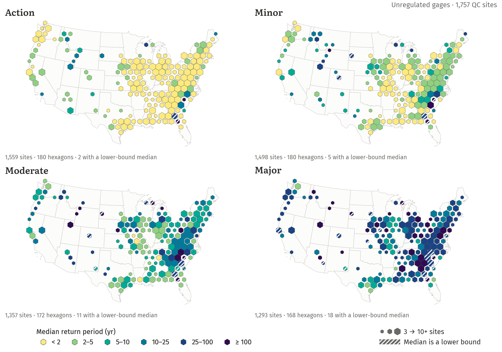{fig-align="center" height="830"}

::: {.small}
1,757 QC sites with no or minor regulation: upstream storage < 0.10 years of mean annual runoff and no regulation peak codes.
:::

## Regulated gages: regional patterns
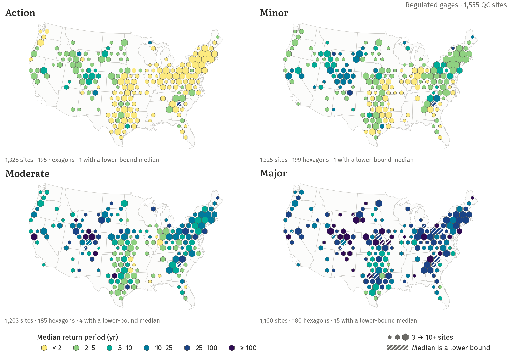{fig-align="center" height="830"}

::: {.small}
1,555 QC sites with moderate or major regulation: storage ≥ 0.10 years of mean annual runoff, or NWIS peak codes 5 / 6.
:::

<!-- ## How far apart are thresholds and design floods?
:::: {.columns}
::: {.column width="50%"}
- Each level paired with the LP3 quantile nearest its typical return period
- Shown: median of (LP3 quantile − NWS flow) / NWS flow

::: {.fragment}
- Positive: the threshold flow sits **below** the design flood, so it is reached more often
:::
:::
::: {.column width="50%"}
| NWS level | Paired quantile | Median difference |
|---|---|---:|
| Action | Q2 | +16% |
| Minor | Q5 | +27% |
| Moderate | Q10 | +8% |
| Major | Q30 | +5% |
:::
::::

::: {.small .fragment}
Thresholds above the rating table have no flow and drop out of this comparison, so the major figure leans low.
::: -->

# Chapter 4: Non-stationarity

## Are the peak records stationary?
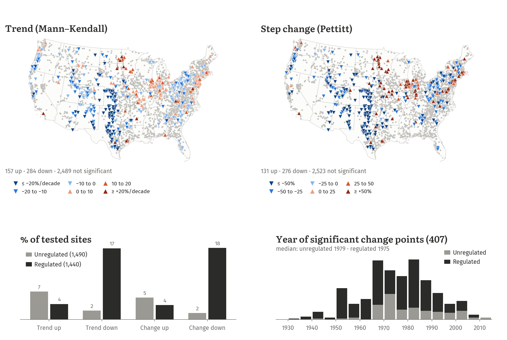{fig-align="center" height="760"}

::: {.takeaway .fragment}
24% of regulated gages show a significant trend or step change, mostly downward around 1975, against 10% of unregulated gages.
:::

## What caused the changes?
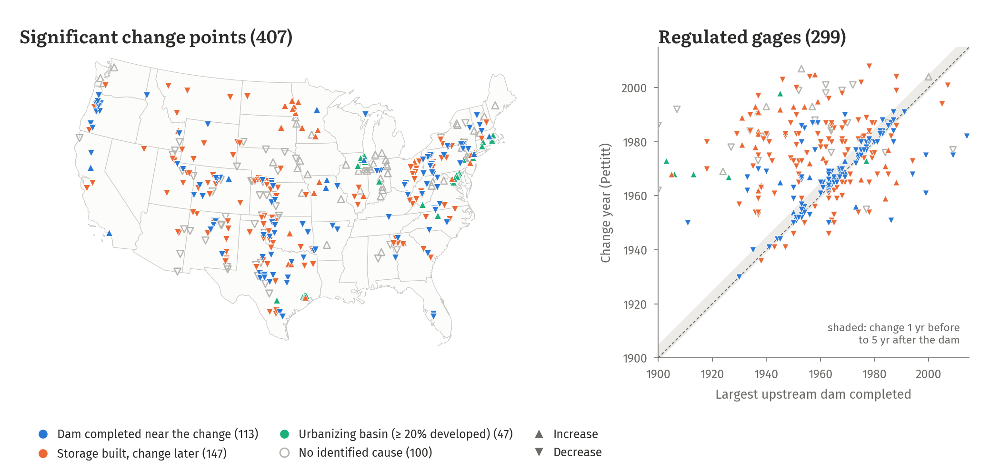{fig-align="center" width="100%"}

::: {.small}
NID dams placed in GAGES-II basins. "Dam completed near the change": dams finished up to 5 years before the change add storage ≥ 5% of mean annual runoff (3× the chance rate). "Storage built, change later": basins with more canals and irrigated agriculture, consistent with diversions.
:::

## Refitting regulated gages on the present-day record
:::: {.columns}
::: {.column width="40%"}
- Bulletin 17C: fit the record under **present-day** regulation
- Cutoff: the later of the largest upstream dam's completion and the first code-6 (regulation or diversion) peak; Pettitt year as fallback
- Refit where ≥ 30 years remain: **833** of 1,440 regulated gages

::: {.fragment}
- Trends left after the cutoff: 62 sites, flagged as gradual change
:::
:::
::: {.column width="60%"}
| Cutoff source | Refit | < 30 yr left |
|---|---:|---:|
| Largest dam completed | 697 | 68 |
| Code-6 onset | 103 | 35 |
| Pettitt change year | 33 | 15 |
| No cutoff needed | 489 | |
:::
::::

## Present-day return periods are longer
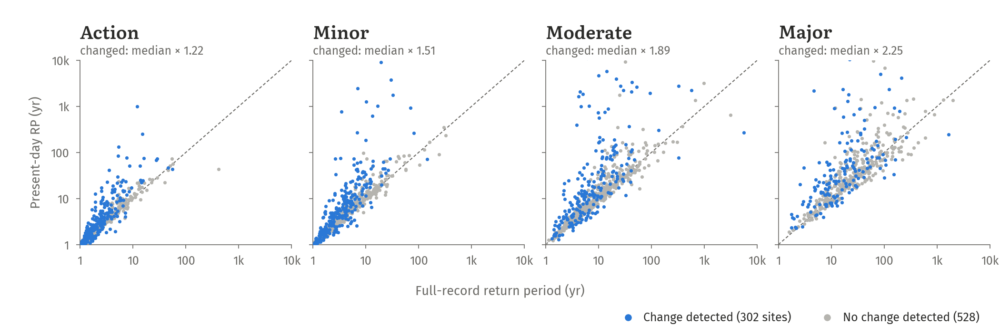{fig-align="center" width="100%"}

::: {.takeaway .fragment}
Where the record changed, the present-day major return period is 2.25× the full-record one at the median gage: the full record counts floods the dams now prevent.
:::

## Regulation, revisited
:::: {.columns}
::: {.column width="55%"}
| Level | Unregulated | Regulated, full record | Regulated, present day |
|---|---:|---:|---:|
| Action | [1.5 yr]{.rp-lt2} | [2.0 yr]{.rp-lt2} | [2.1 yr]{.rp-2-5} |
| Minor | [2.9 yr]{.rp-2-5} | [3.9 yr]{.rp-2-5} | [4.3 yr]{.rp-2-5} |
| Moderate | [10.3 yr]{.rp-10-25} | [10.4 yr]{.rp-10-25} | [12.6 yr]{.rp-10-25} |
| Major | [48.8 yr]{.rp-25-100} | [37.4 yr]{.rp-25-100} | [50.5 yr]{.rp-25-100} |

::: {.small}
Kaplan–Meier medians, lower bounds right-censored. Present day: post-cutoff fits at the 830 refit gages, full-record fits elsewhere.
:::
:::
::: {.column width="45%"}
::: {.incremental}
- Action and minor: still reached **less often** at regulated gages
- Major: the apparent difference **disappears** (50.5 vs 48.8 years)
- The full-record result mixed pre- and post-dam floods
:::
:::
::::

## Takeaways
::: {.incremental}
- NWS levels step up in rarity: **1.7 → 3.3 → 10 → 42 years** at the median gage
- The spread between gages is wide: major flooding ranges from a few years to beyond 100 years
- Regional structure is clear once gages are pooled: short return periods for action and minor across the Midwest, Plains and much of the East; longer ones in arid West
- 30% of major thresholds sit above the rating curve and must be treated as lower bounds
- Regulated gages reach action and minor stages less often; at major, the apparent difference disappears once records are refit on present-day regulation
:::

## Caveats and next steps
:::: {.columns}
::: {.column width="50%"}
**Caveats**

- Station skew everywhere: tail quantiles noisier where regional skew exists
- Regulated gages (47% of QC sites) likely confounded with region
- Present-day refits rest on shorter records (median 58 years) and station skew
- Above-rating thresholds known only as bounds
:::
::: {.column width="50%" .fragment}
**Next steps**

- Data release of the FFA outputs
- Uncertainty bounds on threshold return periods
- Regulation effect within regions (e.g. by HUC2)
- Present-day return periods and change flags in the data release
:::
::::
